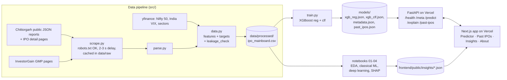

# Predicting listing-day returns of Indian IPOs

Course project for **Machine Learning with Business Data (UE24AM342AA4), PES University**.

Can we predict how an Indian mainboard IPO opens on listing day, using only what is public before
listing (the issue terms, the final subscription numbers, the company's financials and the market mood)?
And can we explain each prediction?

* **Live app:** https://ipo-listing-predictor-three.vercel.app
* **API:** https://ipo-listing-predictor-api.vercel.app (interactive docs at [`/docs`](https://ipo-listing-predictor-api.vercel.app/docs))
* **Report:** [`docs/report.md`](docs/report.md) · **Viva notes:** [`docs/viva_notes.md`](docs/viva_notes.md) · **Data dictionary:** [`docs/data_dictionary.md`](docs/data_dictionary.md)

> Educational project. Not investment advice and not SEBI-registered advice.

## The short answer

| | Test years 2024 to Oct 2026 (290 IPOs) |
|---|---|
| Average miss of the production model (MAE) | **20.1 percentage points** |
| Average miss of "always predict the median gain" | 18.6 points |
| RMSE, model vs median baseline | 27.8 vs 30.1 |
| Up/down ranking (ROC-AUC) | 0.82 |
| Up/down balanced accuracy, model vs subscription rule | 0.75 vs 0.64 |
| Average miss of the grey-market premium (GMP) taken literally | **8.8 points** |

The honest result: on the average miss, the model **does not beat** the naive median on the test
years. It is better on the big listings (lower RMSE) and at ranking IPOs by their chance of listing up.
The main reason is a regime shift: median total subscription jumped from about 9x (2012 to 2022) to about
34x (2023 onward) without listing gains rising to match, so a model that learned "34x means a hot IPO"
over-predicts by about 12 points on average after 2023. The unofficial grey-market premium, read the
evening before listing, beats every model built from official data.

## Problem

Two targets for each IPO:

* `listing_gain_pct` = (listing-day **open** price − issue price) / issue price × 100 (regression)
* `listed_positive` = listing_gain_pct > 0 (classification)

The open price is the NSE open where available, else BSE.

## Architecture



## Dataset

| | |
|---|---|
| Mainboard IPOs | **604**, listed 9 Mar 2012 to 8 Oct 2026 |
| Split (by listing date) | train 2012-2022: 256 · validation 2023: 58 · test 2024+: 290 |
| Features | 35 (33 numeric + exchange + sector) |
| SME IPOs (collected, not modelled) | 1,071, 2020+ |

Sources: [Chittorgarh](https://www.chittorgarh.com) public report API (IPO list, final-day subscription by
investor category) and IPO detail pages (price band, lot size, reservation, anchor portion, financials,
listing-day prices for the target); [InvestorGain](https://www.investorgain.com) GMP pages; Yahoo Finance
via `yfinance` (Nifty 50, India VIX, company sector). Every site's robots.txt allows this crawling.
Requests are spaced 2 to 3 s apart and every page is cached in `data/raw/`, so nothing is fetched twice. No
site blocked the scraper. Cross-check: 488 IPOs matched a public Kaggle dataset, with a median absolute
difference of 0.71 points in listing gain (mostly NSE vs BSE open price).

Feature groups: issue terms (size, price band, fresh-issue share, lot size, retail reservation, anchor
portion), final-day subscription (QIB, NII, bNII, sNII, retail, employee, total), financials from the RHP
(revenue, profit, growth, margin, ROE, debt/equity, post-issue P/E, market cap, promoter holding), market
context as of the close date (Nifty 7/30-day return, India VIX) and IPO-market heat from earlier listings
(number of IPOs in the last 30 days, average gain of IPOs listed in the previous 90 days). Full list with
sources, timing and missing rates: [`docs/data_dictionary.md`](docs/data_dictionary.md).

## Leakage handling

Rule: **no feature may use information from listing day or later.**

* Every feature is registered in `FEATURES` in [`src/data.py`](src/data.py) with its source and when it
  becomes known. `leakage_check()` runs on every build and refuses to write the dataset if:
  * a feature is not in the registry, or its name matches a listing-day or target pattern (`ld_*`, `listing_gain`, `cmp`, `ltp` ...)
  * India VIX was observed after the issue close date
  * any IPO has close date on or after listing date
  * any numeric feature has |Spearman| > 0.95 with the target
  * a GMP reading is dated on or after listing day
* Market-heat features only use IPOs whose **listing date is before this IPO's close date**.
* Listing-day prices are parsed only into `ld_*` columns, which feed the target and nothing else.
* The InvestorGain tracker's GMP column is updated on listing morning, so it is **not** used. The GMP
  experiment uses the latest reading dated strictly before listing day from each IPO's own GMP page.
* `days_close_to_listing` was dropped after EDA: SEBI moved listings to T+3 in 2023, so it encodes the
  calendar year rather than anything about the IPO (KS drift statistic 0.99 between train and test).
* `listing_year` is kept for splitting but never used as a feature.
* Splits are by time, cross-validation is `TimeSeriesSplit`, early stopping and every choice (hyperparameters,
  decision cut-off, blend weight, production model) use the 2023 validation year. The test years are
  scored once.

## Results

### Regression: listing gain (percentage points)

| Model | Val 2023 MAE | Test MAE | Test RMSE | Test R² |
|---|---|---|---|---|
| Median baseline | 25.7 | 18.6 | 30.1 | -0.11 |
| **XGBoost (production)** | **14.8** | 20.1 | 27.8 | 0.05 |
| TabNet | 15.3 | 18.6 | 25.3 | 0.21 |
| fastai MLP | 20.6 | 16.2 | 24.1 | 0.28 |
| Blend 0.95 XGB + 0.05 TabNet | 14.8 | 20.0 | 27.6 | 0.07 |

Cross-validated MAE on 2012-2022 (5-fold TimeSeriesSplit): XGBoost 15.9, TabNet 18.1, fastai 20.9,
median 24.7. The test ranking flips (fastai best), but switching models because of a test score would
make that score meaningless. The flip is explained by bias: on the test years XGBoost over-predicts by
12.1 points on average, TabNet by 9.5, fastai by 5.4. The model that fits the old subscription-to-gain
relationship most closely is hurt most by the shift.

### Classification: lists above issue price

Each model's cut-off is chosen on 2023 (Youden's J). The classifier's scores sit in a narrow band
(roughly 0.55 to 0.75) because most IPOs list up, so a 0.5 cut-off would call every IPO "up".

| Model | Test ROC-AUC | Test balanced accuracy | Test F1 |
|---|---|---|---|
| Rule: total subscription > 2.3x | 0.83 | 0.64 | 0.84 |
| **XGBoost (production)** | 0.82 | **0.75** | 0.78 |
| TabNet | 0.77 | 0.67 | 0.79 |
| fastai MLP | 0.80 | 0.73 | 0.81 |

### Grey-market premium experiment (2020+, fit 2020-2023, test 2024+)

| Inputs | Test MAE | R² | ROC-AUC |
|---|---|---|---|
| GMP % taken literally as the forecast | **8.8** | **0.78** | **0.89** |
| XGBoost: GMP only | 9.5 | 0.76 | 0.87 |
| XGBoost: GMP + subscription | 10.0 | 0.74 | 0.85 |
| XGBoost: all features + GMP | 10.3 | 0.73 | 0.86 |
| XGBoost: all features, no GMP | 19.6 | 0.11 | 0.81 |

Subscription data adds nothing once GMP is known. GMP is kept out of the production model because it
is unofficial, unregulated and easy to manipulate, and the question here is what official pre-listing
data can tell you.

## What SHAP says

* **Subscription is almost the whole model.** Total, retail, QIB and NII subscription are the top four by
  mean |SHAP|; every other feature moves the forecast by about a point on average.
* **Clear thresholds:** QIB subscription adds +8 to +12 points once it passes roughly 70 to 100x and
  matters little below 50x. Retail adds +15 to +20 points above roughly 25 to 50x and almost nothing
  below 20x.
* **Issue size and India VIX barely matter** (within ±1 point).
* **Hot-market features point the "wrong" way:** a high average gain in the previous 90 days and many
  recent IPOs both lower the forecast slightly. These are the most drifted features. Don't read them as
  causal.
* **Where it fails:** Shree Ram Twistex (Mar 2026) had retail 77x and NII 220x but QIB only 3.9x. The
  model said +37%, it opened -35%, and GMP had been -27% the evening before. Euphoric retail and HNI demand
  without institutions makes the model overconfident.
* Built-in XGBoost `weight` importance over-ranks continuous features that are split on often for
  tiny gains (VIX is 12th by weight, 28th by SHAP). A black-box Permutation explainer agrees with TreeSHAP
  on individual predictions (Spearman 0.85).

## Repository layout

```
src/            scrape.py, parse.py, data.py (features, targets, leakage check), features.py, evaluate.py, train.py
notebooks/      01_eda, 02_classical_ml, 03_deep_learning, 04_blend_and_explain (.ipynb with outputs)
notebooks/src_py/  the same notebooks as # %% scripts (source of truth)
models/         exported XGBoost models + metadata.json + past_ipos.json
backend/        FastAPI app, tests, Dockerfile (also deployable on any container host)
frontend/       Next.js 15 App Router + TypeScript + Tailwind + Recharts
scripts/        build_notebooks.py, sync_backend.py, smoke_test.py
docs/           report.md, viva_notes.md, data_dictionary.md, figures/
```

## Run it locally

```bash
# research environment (Python 3.12/3.13)
python -m venv .venv && .venv/Scripts/activate        # or source .venv/bin/activate
pip install -r requirements.txt

python -m src.data            # build data/processed from the cached raw data (re-scrape: python src/scrape.py lists|sme|details|gmp)
python -m src.train           # train + export models/ (needs models/best_params.json from notebook 02)
cd notebooks && python ../scripts/build_notebooks.py 02   # execute a notebook from its # %% source
python scripts/sync_backend.py   # copy features.py + model artifacts into backend/

# API
cd backend && pip install -r requirements.txt -r requirements-dev.txt
pytest -q
uvicorn app.main:app --reload --port 8000

# frontend
cd frontend && npm install
echo NEXT_PUBLIC_API_URL=http://localhost:8000 > .env.local
npm run dev                   # http://localhost:3000

# end-to-end check against deployed (or local) URLs
python scripts/smoke_test.py --api https://ipo-listing-predictor-api.vercel.app --web https://ipo-listing-predictor-three.vercel.app
```

## Limitations

* **Small data:** 604 IPOs, and only 256 in the training years. 2023 validation is a single year of 58 IPOs.
* **Regime shift:** the relationship between subscription and listing gain changed after 2023. The model
  over-predicts the test years by about 12 points on average.
* **Thin tails:** extreme listings (+180%) are under-predicted and big losers are predicted near 0%, because
  trees cannot extrapolate beyond the training range and few training IPOs lost heavily.
* **Missing data:** bNII/sNII split exists only from 2022, post-issue P/E is missing for about half the IPOs,
  and older detail pages lack some financial tables.
* **Paywalled data:** day-wise category subscription on detail pages needs a login, so only final-day
  totals from the public report are used.
* **Open price only:** the target is the opening price; intraday moves are not modelled.
* **SME IPOs** were collected (1,071) but not modelled: fewer columns are public and the market behaves differently.
* **Not advice.** This is a course project, not a trading tool.

## Future work

* Subscription **relative to recent IPOs** (for example total_x divided by the trailing median of the last
  90 days), which should adapt to the post-2023 regime. This was found by looking at test errors, so it
  has to be judged on new IPOs listed after Oct 2026, not on this test set.
* Rolling retraining every quarter, and monitoring bias on newly listed IPOs.
* Quantile or conformal prediction intervals instead of a single MAE-based note.
* Model the SME segment separately.
* Day-wise subscription curves (how demand built over the three days) if a licensed source is available.

## Deployment notes

The spec planned the API for a Hugging Face Docker Space. Hugging Face now requires a paid plan to host
Docker Spaces, so the same FastAPI app runs as a Vercel Python function (`xgboost-cpu` keeps the bundle
within Vercel's size limit). `backend/Dockerfile` is unchanged and runs on any container host.
CORS allows only the production frontend, its preview URLs under the same Vercel team, and localhost.
