# Predicting listing-day returns of Indian IPOs using pre-listing subscription and market data

Machine Learning with Business Data (UE24AM342AA4), PES University · Project report

Live app: https://ipo-listing-predictor-three.vercel.app · API: https://ipo-listing-predictor-api.vercel.app ·
Code: https://github.com/Aarti-panchal01/ipo-listing-predictor

> Educational project. Not investment advice and not SEBI-registered advice.

## 1. Problem and data

**Business question.** An investor applying to an Indian mainboard IPO knows the issue terms, the
company's financials and, by the close of bidding, how heavily each investor category subscribed. Does
that information predict the listing-day gain, and which parts of it matter?

**Targets.** `listing_gain_pct` = (listing-day open − issue price) / issue price × 100 (NSE open, else BSE),
and `listed_positive` = gain > 0.

**Data collection.** I wrote a polite scraper (`src/scrape.py`) for Chittorgarh's public JSON report API (IPO
list, final-day subscription by category) and its IPO detail pages (issue structure, anchor portion,
financials from the RHP, listing-day prices), InvestorGain's GMP pages, and Yahoo Finance (Nifty 50, India
VIX, company sector). robots.txt allows all of it. Requests wait 2 to 3 seconds and every response is
cached in `data/raw/`. No site blocked the scraper. The result is **604 mainboard IPOs listed between
9 Mar 2012 and 8 Oct 2026**, 35 model features, plus 1,071 SME IPOs that were collected but not modelled.
A cross-check against a public Kaggle dataset matched 488 IPOs with a median difference of 0.71 points in
listing gain.

**Leakage.** Every feature is registered with its source and the moment it becomes known
(`FEATURES` in `src/data.py`). `leakage_check()` stops the build if a feature is unregistered or looks
like listing-day data, if VIX is observed after the issue close date, if a close date is not before the
listing date, if a feature has |Spearman| > 0.95 with the target, or if a GMP reading is dated on or after
listing day. Market-heat features only use IPOs listed before this IPO's close date.

**Split.** By listing date: train 2012-2022 (256 IPOs), validation 2023 (58), test 2024 onward (290).
Every modelling choice uses the training years or the 2023 validation year; the test years are scored once.

## 2. Unit 1: exploratory data analysis (`notebooks/01_eda.ipynb`)

* **The target is skewed:** mean 18.6%, median 8.2%, standard deviation 31.9, skew 2.28, kurtosis 7.9.
  69.2% of IPOs list above the issue price and 7.1% exactly flat. 34 IPOs (5.6%) are IQR outliers, from
  Sigachi Industries (+250%) to Om Freight Forwarders (−40%). This is why the regression models use
  Huber / pseudo-Huber loss and MAE is the headline metric.

  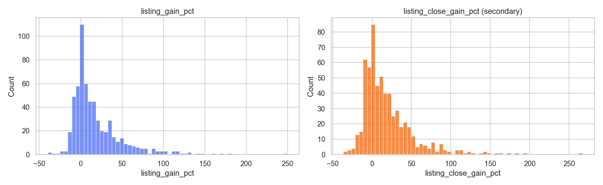

* **Subscription is the strongest signal.** Spearman correlation with the gain: total 0.76, QIB 0.73,
  NII 0.70, bNII 0.63, sNII 0.61, retail 0.60, employee 0.36. Subscription multiples are heavily
  right-skewed, so they enter the models as log1p.

  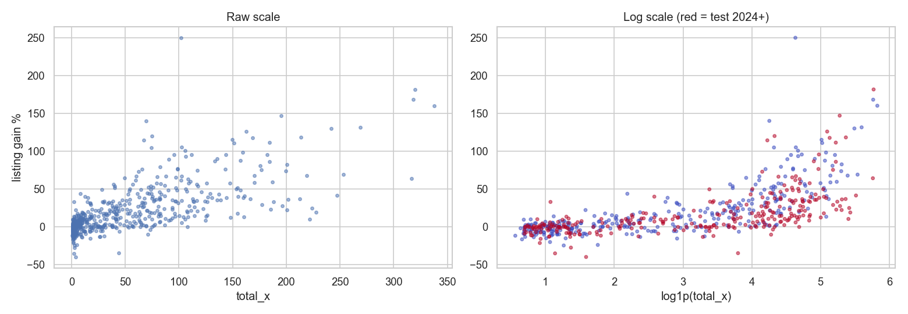

* **The years differ a lot.** 2020-2021 and 2023-2024 were hot (median gain 15 to 36%), 2015, 2018 and 2022
  were cold (median 1 to 3%). Median total subscription was mostly 2 to 11x a year before 2020 (2014's five IPOs aside) and 29 to 54x since 2023.

  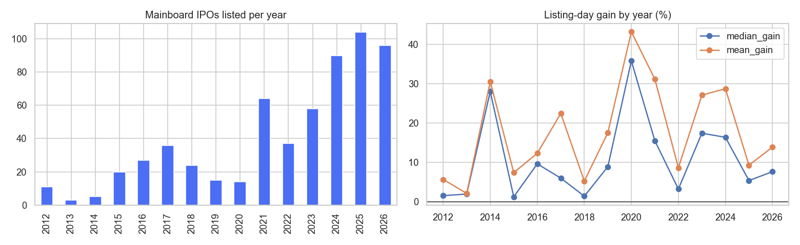

* **Drift between train and test** (Kolmogorov-Smirnov): `days_close_to_listing` 0.99 (SEBI's T+3 rule
  in 2023, so the feature was dropped), number of IPOs in the previous 90 days 0.75, IPOs in the last
  30 days 0.60, bNII/sNII about 0.45 (these only exist from 2022), QIB and retail about 0.24.
* **Missing data is structured, not random:** the bNII/sNII split is missing for all pre-2022 IPOs (37%),
  post-issue P/E for about half, and some financial ratios for older issues. Missingness is therefore kept
  visible (native NaN in XGBoost, missing-indicator columns for the neural nets).

  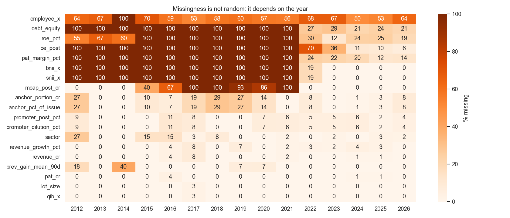

* **Sector** matters less than expected: Basic Materials and Industrials have the highest median gains
  (14.9% and 10.5%), Real Estate the lowest (0.2%), but sector groups are small.

## 3. Unit 2: classical machine learning (`notebooks/02_classical_ml.ipynb`)

**Baselines.** Regression: always predict the training median (5.0%). Classification: "up if total
subscription > t", with t chosen on training data by F1 (t = 2.0x). On 2023 the median baseline has
MAE 25.7; the subscription rule has ROC-AUC 0.85, a hard bar to beat.

**Pipeline.** A scikit-learn `Pipeline` with a `ColumnTransformer`: median imputation with missing
indicators and standard scaling for numbers, one-hot encoding for exchange and sector (67 columns).

**Four tree models on 2023 validation (MAE):** single decision tree (depth 4) 21.4, Extra Trees 14.8,
Gradient Boosting with early stopping (128 trees) 14.5, XGBoost with early stopping (164 trees) 14.8.
All ensembles beat the baseline by about 11 points and sit within 0.3 points of each other.

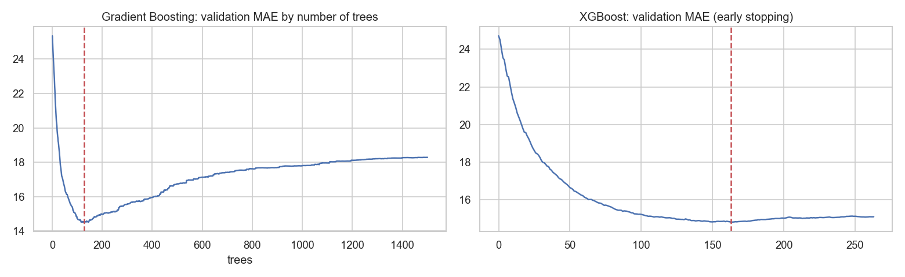

**Imputation vs native missing handling.** Same XGBoost, only the NaN treatment changes: native 14.59,
median + indicators 14.75, iterative (BayesianRidge) 14.86, median 14.88, KNN 14.89, mean 14.93. The
spread (0.35 points on 58 IPOs) is noise; native handling is simplest and was kept.

**Feature selection.** Four methods on the training years only: stability selection (Lasso on 200
half-samples), Boruta, forward and backward sequential selection. Total, retail, sNII and QIB subscription,
IPO-market heat and ROE get at least 3 of 4 votes. A 6-feature model with these does slightly better on
2023 (13.8 vs 14.6), but the production model keeps all features: trees ignore weak features, the
difference is within the noise of one 58-IPO year, and the web app's explanation needs every input.

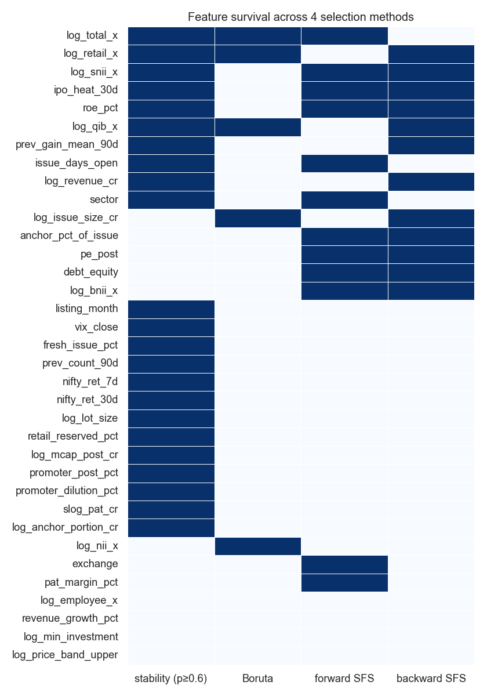

**Hyperparameter search, same budget and same objective** (5-fold TimeSeriesSplit CV MAE on 2012-2022):

| Method | Fits | CV MAE | 2023 MAE |
|---|---|---|---|
| Manual (hand-picked) | 5 | 15.86 | **15.21** |
| Grid search | 270 | 14.98 | 15.92 |
| Random search | 270 | 15.14 | 16.45 |
| Bayesian (Optuna TPE) | 270 | **14.75** | 15.83 |

Every search beat the hand-picked settings on CV and **lost** to them on the next year. The searches
fitted the 2012-2022 regime. Optuna found the best CV score with the same budget. Production uses the
settings with the best 2023 MAE (manual: depth 3, learning rate 0.03, pseudo-Huber loss).

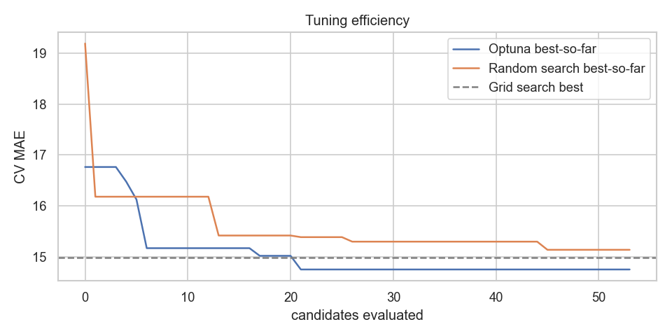

**Decision cut-off.** The tuned classifier's probabilities sit in a narrow band (about 0.55 to 0.75), so
a 0.5 cut-off calls every IPO "up" (test balanced accuracy 0.50). Choosing the cut-off on 2023 by Youden's
J (0.71) gives test balanced accuracy 0.75, against 0.64 for the subscription rule.

## 4. Unit 3: deep learning on tabular data (`notebooks/03_deep_learning.ipynb`)

**TabNet** (HuberLoss δ = 10, entmax attention, embeddings for exchange and sector, early stopping on 2023)
and a **fastai tabular learner** (two hidden layers 128/64, dropout, weight decay, epochs chosen on 2023).

| Model | CV MAE 2012-22 | Val 2023 MAE | Test MAE | Test bias | Test ROC-AUC |
|---|---|---|---|---|---|
| Median | 24.7 | 25.7 | 18.6 | | |
| XGBoost | **15.9** | **14.8** | 20.1 | +12.1 | **0.82** |
| TabNet | 18.1 | 15.3 | 18.6 | +9.5 | 0.77 |
| fastai MLP | 20.9 | 20.6 | **16.2** | +5.4 | 0.80 |

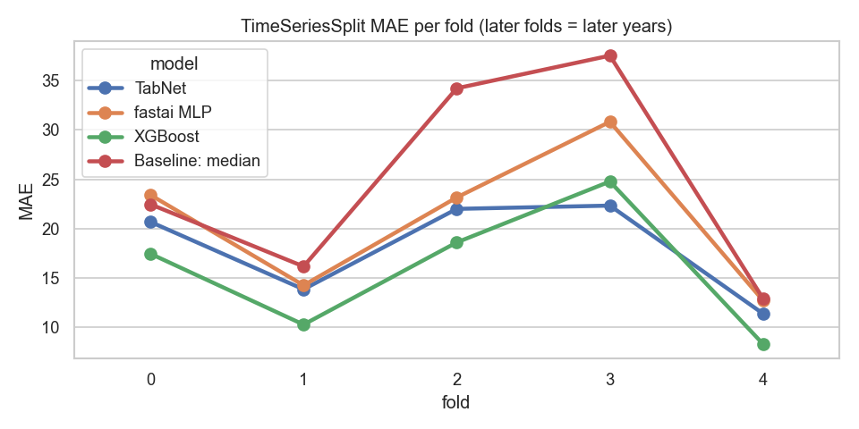

On the years used to choose models the trees win clearly: 256 training rows is very little for a neural
net, and trees take skewed, partly missing, mixed-type columns as they are. On the test years the ranking
flips. All models over-predict there, and the most heavily regularised net, which is pulled most toward
the average, suffers least from the post-2023 shift. The test ranking was **not** used to switch models.

Two bugs found and fixed while building this notebook: fastai's `FillMissing` appends its `_na`
columns to the category list *in place*, which silently changed the shared feature list; and columns that
are completely empty in an early CV fold (bNII/sNII, P/E) had to be set to a constant, or `Normalize`
divided later values by a zero standard deviation and the fold MAE exploded to 10^10.

## 5. Unit 4: blending and interpretability (`notebooks/04_blend_and_explain.ipynb`)

**Blend.** TabNet is the better deep model on 2023. The best 2023 weight is 0.95 XGBoost + 0.05 TabNet,
which improves 2023 MAE by only 0.03 points. On test the blend is 0.14 points better than XGBoost
(paired bootstrap 95% CI 0.07 to 0.20): statistically detectable, practically nothing. The production
model was chosen on validation, with a half-point bar for shipping a second (PyTorch) model: **XGBoost alone**.

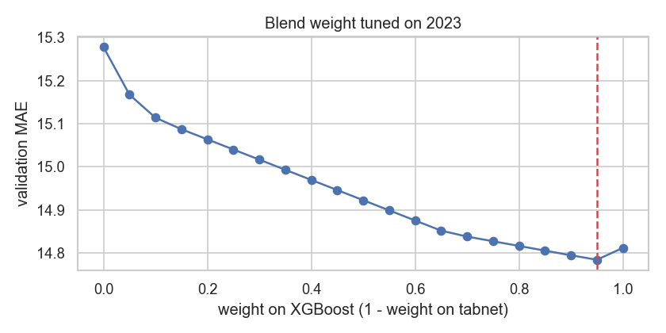

**Global SHAP** (TreeSHAP from XGBoost's own `pred_contribs`, which the API also uses):

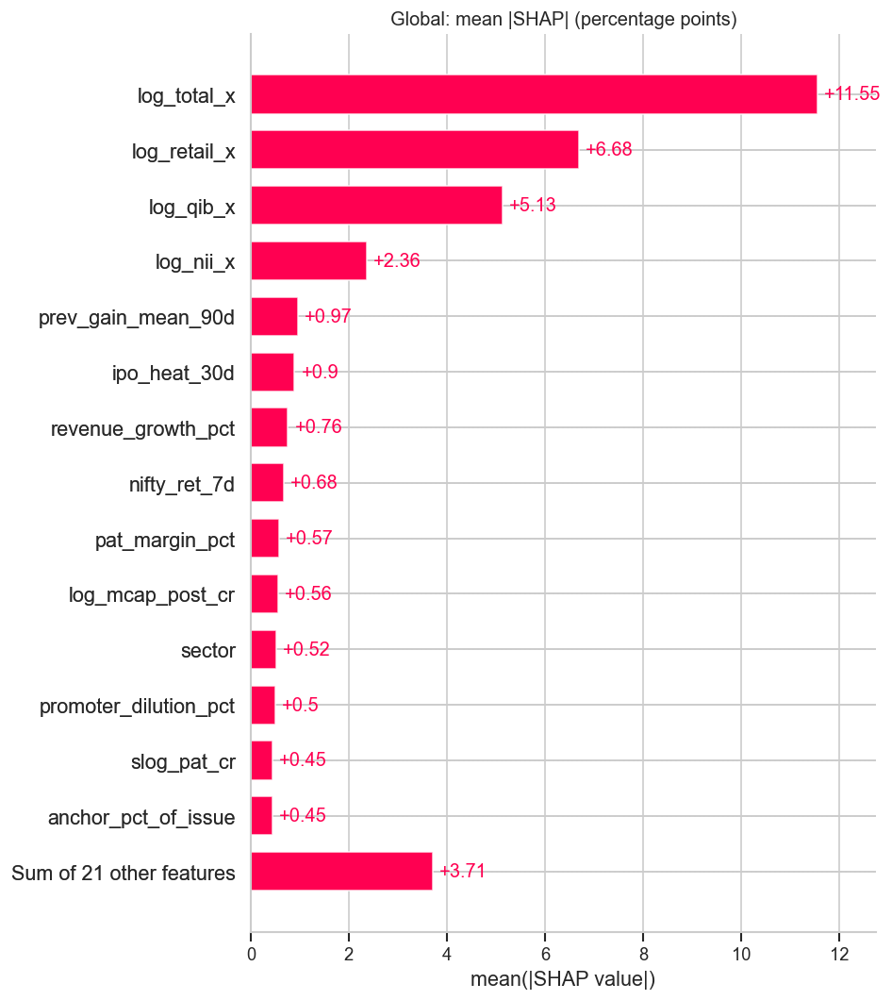
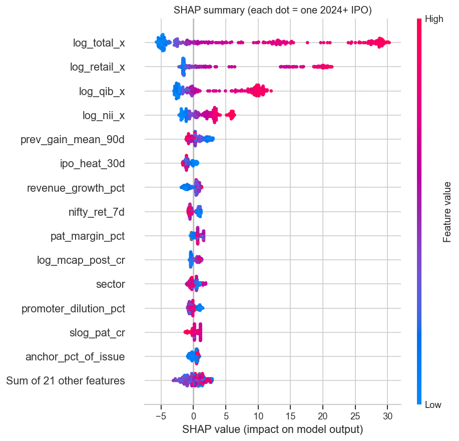

Total, retail, QIB and NII subscription dominate. Low subscription pushes the forecast 2 to 5 points below
the base value of 9.1%, very high subscription pushes it up 10 to 30 points.

**Dependence plots** for QIB, retail, issue size and India VIX:

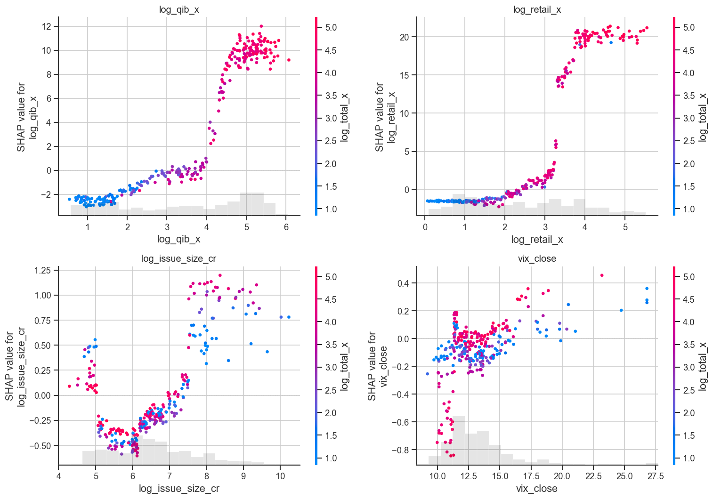

QIB has a step from about 0 to +10 points between roughly 50x and 100x. Retail has a step from about 0 to
+15 to +20 points between roughly 20x and 50x. Issue size and VIX stay within ±1 point.

**Three individual IPOs:**

* Big winner, **Vibhor Steel Tubes** (Feb 2024): actual +181.5%, predicted +73.6%. 320x subscription, all
  subscription features push up. Right direction, but trees cannot go beyond the largest values seen in training.

  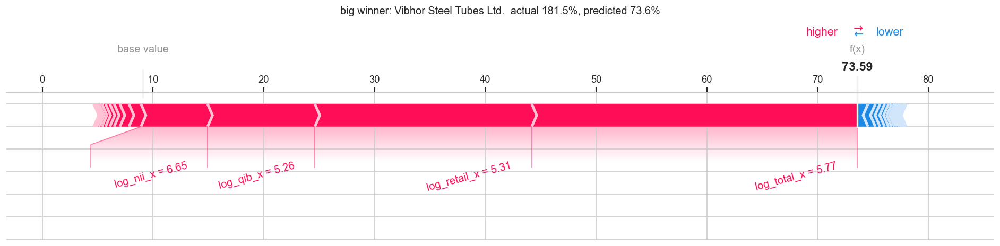
* Big loser, **Om Freight Forwarders** (Oct 2025): actual −39.6%, predicted −0.4%. Weak demand everywhere
  (3.9x). Right signal, but few training IPOs lost this much, so the loss tail is shrunk.

  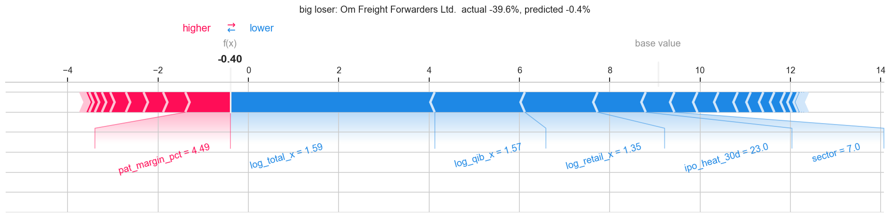
* Surprise, **Shree Ram Twistex** (Mar 2026): actual −34.6%, predicted +37.3%. Retail 77x and NII 220x, but
  QIB only 3.9x; retail alone added +20 points. GMP was −27% the evening before.

  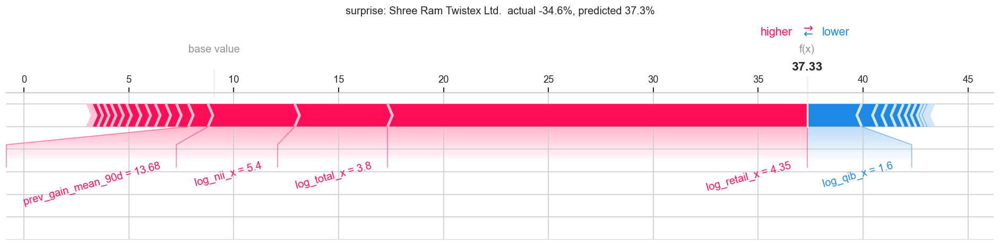

A black-box Permutation explainer (it only calls `predict`) agrees with TreeSHAP on the surprise IPO
(Spearman 0.85 across features). The only notable gap is total subscription, which is correlated with
retail and NII, and the two methods split shared credit differently.

**Built-in importance vs SHAP.** All measures put total subscription first. `weight` (split counts) is
the least trustworthy: it ranks VIX 12th while SHAP ranks it 28th, because continuous features get split
on often for tiny gains. `gain` over-rewards rarely used features that happened to land on a lucky split
(net profit: 7th by gain, 13th by SHAP). Permutation importance on test is near zero for most features
under the regime shift.

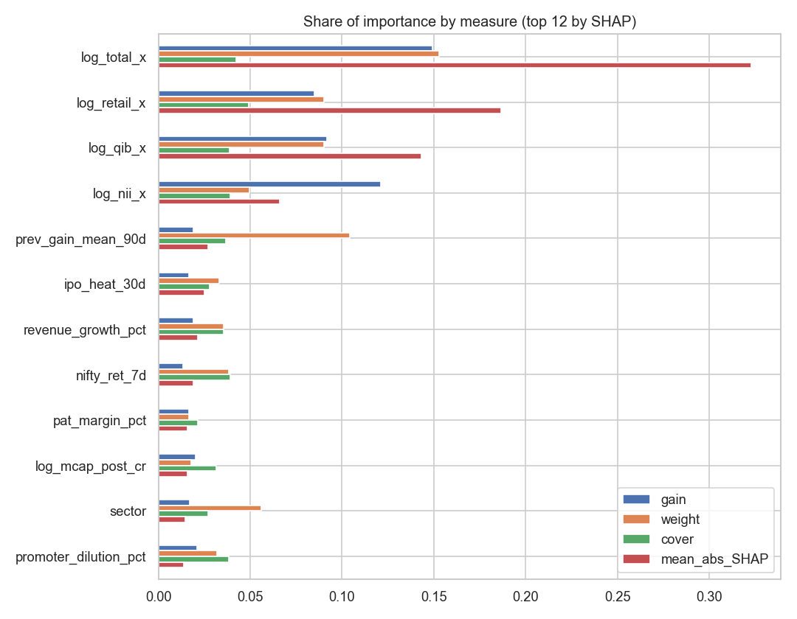

**Does subscription add value beyond GMP?** On 2020+ IPOs with a pre-listing GMP reading (fit 2020-2023,
test 2024+): GMP taken literally as the forecast has MAE 8.8 and R² 0.78, XGBoost on GMP alone 9.5, GMP +
subscription 10.0, all features + GMP 10.3, all features without GMP 19.6. **No: subscription adds nothing
once GMP is known.** The grey market already prices in demand and mood, and it is read later. GMP stays
out of the production model because it is unofficial and unregulated.

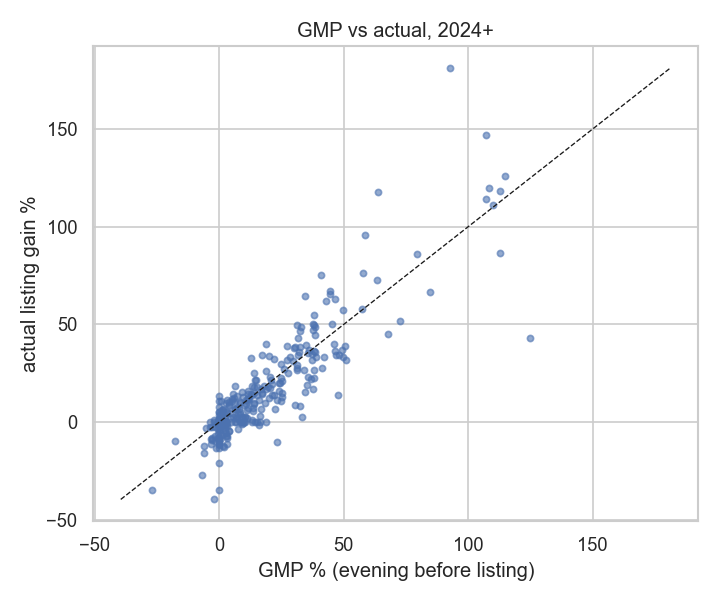

## 6. Deployment

* **Model export:** `src/train.py` early-stops on 2023, refits on 2012-2023 with that number of trees, and
  writes `models/xgb_reg.json`, `xgb_clf.json`, `metadata.json` (features, categories, input ranges,
  decision cut-off, validation, test and baseline metrics, a prefilled example) and `past_ipos.json`.
* **API:** FastAPI with `GET /health`, `GET /meta`, `POST /predict`, `POST /explain`, `GET /past-ipos`.
  Pydantic validates every input (ranges, required fields, unknown fields rejected, anchor ≤ issue size).
  CORS is limited to the production frontend, its Vercel previews and localhost. 13 pytest tests. The spec
  planned a Hugging Face Docker Space, but Hugging Face now charges for Docker Spaces, so the API runs as a
  Vercel Python function (the Dockerfile still works on any container host).
* **Frontend:** Next.js 15 (App Router, TypeScript, Tailwind) with Predictor (prefilled example, SHAP
  waterfall), Past IPOs (predicted vs actual on the test years, filters), Insights (charts from the
  notebooks' exported JSON) and About. A disclaimer is on every page. The API client retries with backoff
  and shows a "waking up" message for cold starts.
* **Smoke test:** `scripts/smoke_test.py` checks every endpoint, validation, filters, every page, the
  bundled API URL and CORS from the real origin. 17/17 checks pass on the deployed URLs.

## 7. Conclusions

1. Official pre-listing data ranks IPOs well (ROC-AUC 0.82) but predicts the size of the listing gain
   poorly in 2024-2026: MAE 20.1 against 18.6 for the naive median.
2. The relationship between subscription and listing gain shifted after 2023. Subscription levels rose
   about fourfold without gains following, and every model trained on 2012-2022 over-predicts.
3. QIB and retail subscription carry almost all the signal, with clear thresholds. Market-level features
   (VIX, Nifty returns) add almost nothing.
4. The grey-market premium alone beats all of it (MAE 8.8).
5. Methodological lessons: CV-optimal hyperparameters did not survive one year ahead; probability cut-offs
   must be chosen, not assumed; and model choice must be made before looking at test scores, even when
   the test ranking flips.
